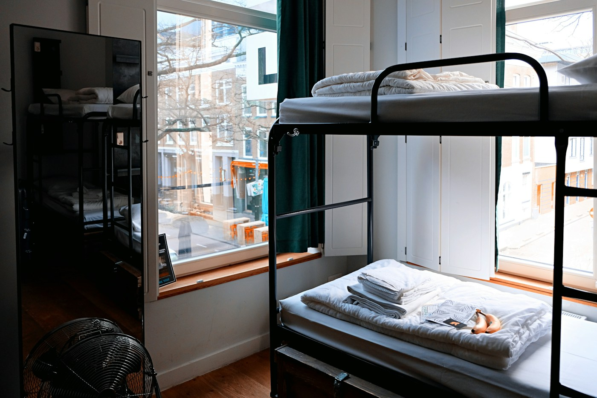

# Taste Translator 🪴

### Bring your saved ideas. Make a room that feels like everyone.

A visual room planning prototype that helps people bring different decorating tastes together, find common ground, and make decisions within a shared budget.



## The story behind it

Growing up, I shared one room with my three siblings, including my brother. Four kids, one room, and four different ideas of what it should look like.

Later, when I had a university roommate, I faced that same question again: how do you make a shared space feel like it belongs to everyone?

Taste Translator grew from that experience. I wanted to turn the inspiration people save into choices they can actually agree on.

## From inspiration to a shared plan

**Add inspiration → Add your people → Find shared style → Vote → Review your room**

Start with Maya and Alex, two roommates with different tastes and a $600 decorating budget, or create a room of your own.

<table>
<tr>
<td><strong>Maya</strong><br>Warm colors, sage, soft textiles, and natural wood.</td>
<td><strong>Alex</strong><br>Charcoal, metal, simple shapes, and practical furniture.</td>
</tr>
</table>

## Explore the demo

* **Collect ideas:** Build a visual board with room inspiration, furniture, lighting, textiles, and decor.
* **Make it personal:** Customize avatars, explore visual taste questions, and separate “My corner” from “Our space.”
* **Find common ground:** See explainable suggestions based on confirmed preferences, with equal weight for each member.
* **Make decisions:** React with “Love it,” “Let’s discuss,” or “Pass,” and explore compromises when opinions differ.
* **Keep the budget in view:** Track selected purchases, estimated spending, and the amount remaining.
* **Preview your space:** Explore an interactive 3D room and enter room and furniture measurements.
* **Take your plan with you:** Export inspiration as CSV and save your room plan and shopping checklist.

## What this version supports

This repository contains the **browser saved demo**.

Room plans, preferences, votes, and avatar choices stay in the current browser. Members can be switched within the demo to explore different perspectives.

| Feature | Status |
| :--- | :--- |
| Inspiration boards and manual ideas | Available |
| Preferences, voting, and compromise prompts | Available |
| Explainable rule based matching | Available |
| Deterministic budget calculations | Available |
| Five field CSV import and export | Available |
| Interactive 3D preview and measurement entry | Available |
| Sample Pinterest boards and editable taste observations | Available as demo content |
| Live Pinterest authorization | Requires backend integration and approved access |
| Shared editing across devices and invitation delivery | Planned |
| Room photo uploads and cloud storage | Requires backend support |
| Live AI recommendations | Unavailable in this demo |

Suggestions use rules rather than a live AI service. Prices are estimates, and the preview does not verify real world furniture fit.

## Built with

**React · TypeScript · Vite · Tailwind CSS · Zod · Lucide**

The visual identity combines warm ivory, sage, terracotta, editorial typography, room photography, and playful illustrated details.

## Run locally

Requires Node.js 22.13 or newer.

```bash
npm ci
npm run dev
```

Check the planner logic and create a production build:

```bash
npm test
npm run build
```

Planner tests cover preference matching, recommendation ranking, approval rules, budget calculations, CSV handling, and member management.

## Deploy

Import this repository into Vercel with the **Vite** preset.

**Build command:** `npm run build`  
**Output directory:** `dist`

No environment variables are required for this demo. See [START_HERE.md](START_HERE.md) for the complete setup guide.

## A note on privacy

This demo has no account system or cloud backup. People using the same browser profile can access its saved room. Clearing browser data removes local progress.

Taste Translator is an independent project and is not affiliated with Pinterest.

<br>

**Created by Zeynab Huseynli**

*A little you + a little them.*
